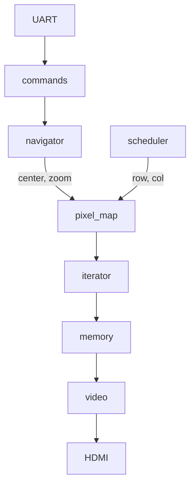

# Mandelbrot Explorer

Mandelbrot set explorer on the Tang Nano 20K (GW2AR-18).
320×240×8 framebuffer in BSRAM, each pixel and line repeated 2× for HDMI 640×480.
Pan and zoom over UART at 115200 8N1 (default port `/dev/ttyUSB1`).

Coordinates are Q4.32 (36 bits, 4 integer). The iteration cap is 255, zoom runs from 0 to 31, and one pan step is 8 pixels. `clk_calc` is 135 MHz; the pixel clock is 25.2 MHz.



The iterator is a 4-deep recirculating pipeline (up to four pixels in flight). Any nav key restarts the scan and recomputes the whole frame. Video reads the framebuffer on the pixel clock.

## Navigate

```
w a s d  or arrows    pan
e  +  =               zoom in
q  -  _               zoom out
r                     reset (center, zoom 0)
```

`make serial` opens the port. Leave `screen` with Ctrl+A, then K, then y.

## Requirements

`make test`, `make check`, and `make lint` need GHDL and [uv](https://docs.astral.sh/uv/) on `PATH`.

`make build` and `make flash` also need:

- Gowin IDE at `~/gowin/IDE` (`GOWIN_HOME`)
- openFPGALoader at `~/openFPGALoader/build/openFPGALoader` (`OPENFPGALOADER`)

## Board access

To flash and open the serial port without `sudo`:

```bash
./tools/setup_fpga_access.sh
```

Then log out and back in (`dialout` group + FTDI udev rule).

## Build

```bash
make sync      # Python deps (uv)
make test      # VUnit (make test p=8 ARGS='*tb_pipe*')
make check     # GHDL analyze
make lint      # VSG
make fmt       # VSG --fix
make build     # Gowin bitstream
make flash
make serial    # UART nav (default: /dev/ttyUSB1)
make all       # build && flash
make clean
```

## TODO

- [x] Pipeline the compute path to raise `clk_calc`
- [ ] Reuse already computed pixels on pan/zoom (only redraw the newly exposed region)
- [ ] Move the framebuffer to external SDRAM → higher resolution
- [ ] Add schematic
- [ ] Add sample images
- [ ] Load palette from an external file
- [ ] Parameterize video timing and FB→screen scale
